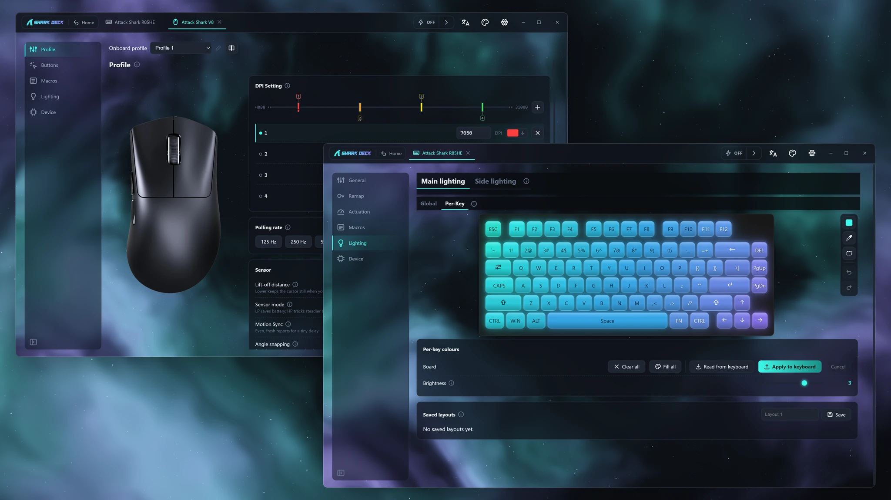
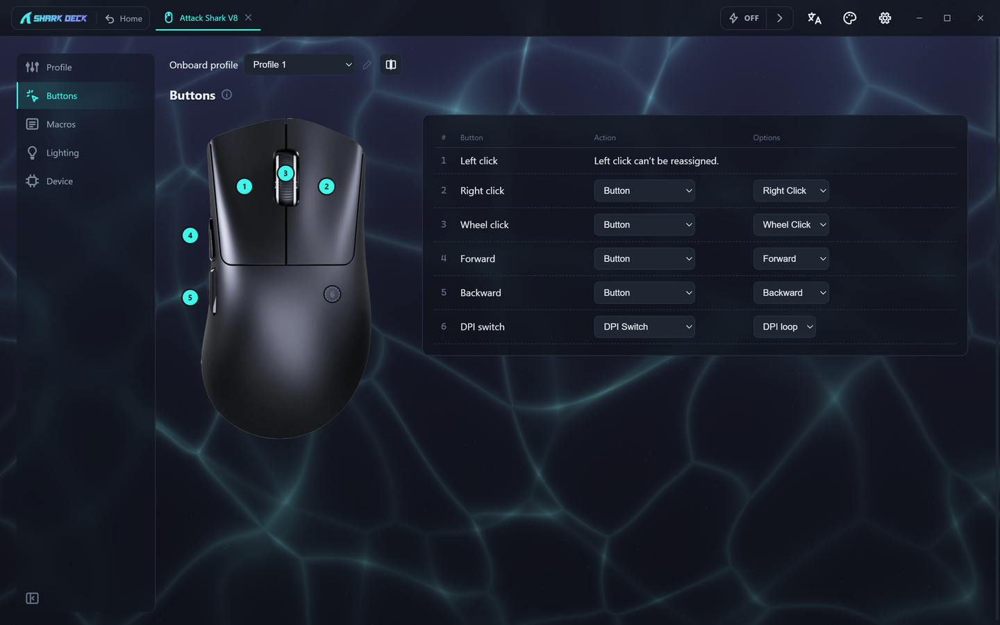
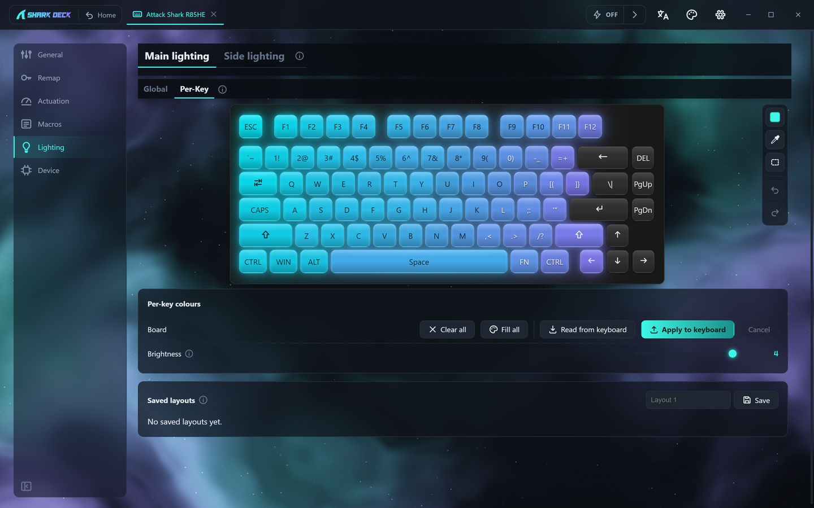
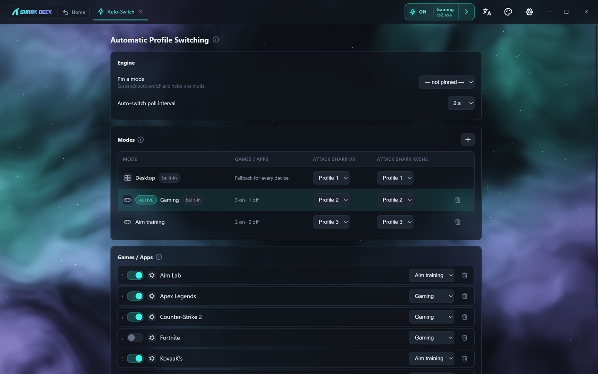

<p align="center"></p>

<p align="center">
  <a href="https://github.com/alexandrewillame/shark-deck/releases/latest"></a>
  <a href="https://github.com/alexandrewillame/shark-deck/actions/workflows/build.yml"></a>
  
  <a href="https://alexandrewillame.github.io/shark-deck/"></a>
  
  <a href="LICENSE"></a>
</p>

# Shark Deck

One open-source app to configure Attack Shark mice and keyboards: DPI, buttons,
lighting, Hall-effect actuation, macros and per-game profiles. No account, no
telemetry, and it works offline.

**[Open it in your browser](https://alexandrewillame.github.io/shark-deck/)** ·
[Download for Windows, macOS and Linux](https://github.com/alexandrewillame/shark-deck/releases/latest) ·
[Report a problem](https://github.com/alexandrewillame/shark-deck/issues)

## Supported devices

**[Full list, model by model](docs/devices/attack-shark-lineup.md)**

- 🟢 **Tested:** the R85 HE and R98 HE keyboards and the V8 mouse.
- 🟡 **Should work:** about 75 more keyboards, and the X11 ULTRA, original X11,
  F1 AIR, R2, R3, X3 PRO, R5 ULTRA, R6 and R8 mice.
- 🟠 **Partly supported:** three keyboards, and the X8, X8 PRO, V5, R11 ULTRA,
  RS3/RS6 ULTRA, V2 AIR, MEGA B2 and R5 TURBO mice.
- ⚪ **Recognised only:** the X1, X8 PLUS, R1, X3 and X6.

**Your device is not listed, or only partly supported?** Its Device tab in
Shark Deck starts the
[device report tool](docs/devices/attack-shark-lineup.md#missing-a-device) for
it; or run the tool yourself. Then attach the file it saves to a
[new device request](https://github.com/alexandrewillame/shark-deck/issues/new?template=new-device.yml).
That report is what we add devices from.

## Use it in your browser

[alexandrewillame.github.io/shark-deck](https://alexandrewillame.github.io/shark-deck/)
is the same app with nothing to install. Open it in Chrome, Edge or Opera on a
computer, click **Connect a device** and pick your mouse or keyboard. Limitations: 
Per-game switching and the tray icon need the desktop app, and Firefox and Safari 
cannot reach USB devices ([details](docs/platform-support.md#browser-edition-webhid)).

## Walkthrough

**Mouse:** DPI, polling rate, sensor settings, angle mode, buttons, macros, lighting.

<p align="center"></p>

**Keyboard:** Hall-effect actuation with live key travel, rapid trigger, macros, RGB lighting.

<p align="center"></p>

**Per-game auto-switching:** start a game and the mouse and keyboard both move to its profile; close it and they move back.

<p align="center"></p>

| DPI & polling rate | Sensor & angle mode | Button remapping |
|---|---|---|
|  |  |  |
| **Live key travel & rapid trigger** | **Lighting effects** | **Per-key RGB** |
|  |  |  |
| **Macro editor** | **Per-game auto-switching** | **Light theme** |
|  |  |  |

## Build from source

```bash
cd app
npm install
npm run dev       # the desktop app, with hot reload
npm run dev:web   # the browser edition, on http://127.0.0.1:5174
npm run dist      # this computer's installers, in dist/
```

Node 24 (22.22 or later works). Each OS builds its own installers. More in
[`app/README.md`](app/README.md) (architecture, every build target),
[`docs/protocol/`](docs/protocol/README.md) (the wire protocols) and
[`docs/platform-support.md`](docs/platform-support.md) (what each OS needs).

## License

Copyright © 2026 Alexandre Willame. Shark Deck is free software under the
[GNU General Public License, version 3 or later](LICENSE), with no warranty.
