<p align="center">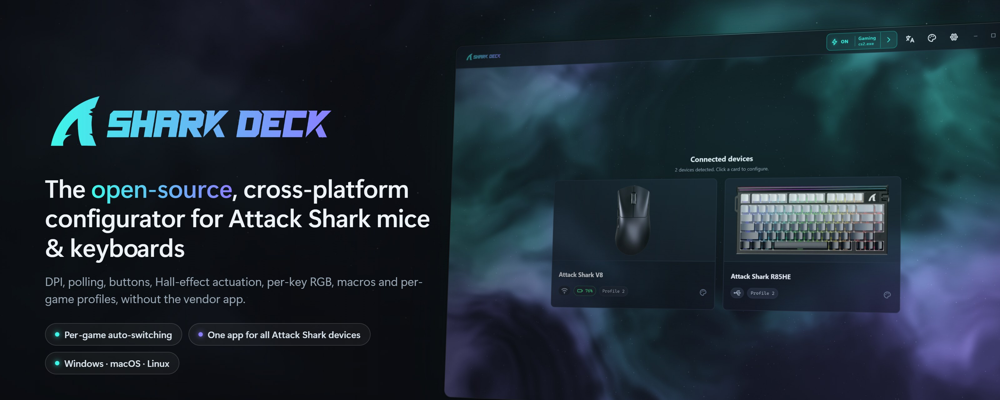</p>

# SharkDeck workspace

Open-source configurator for Attack Shark keyboards and mice — an auditable,
offline replacement for the vendor's _Mouse Hub_ and _Driver v4_.

## Walkthrough

**Mouse:** DPI, polling rate, sensor settings, angle mode, buttons, macros, lighting.

<p align="center">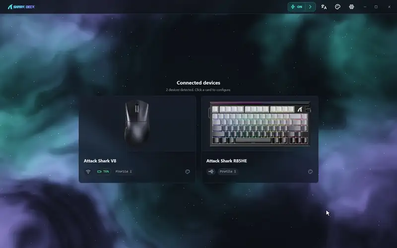</p>

**Keyboard:** Hall-effect actuation with live key travel, rapid trigger, macros, RGB lighting.

<p align="center">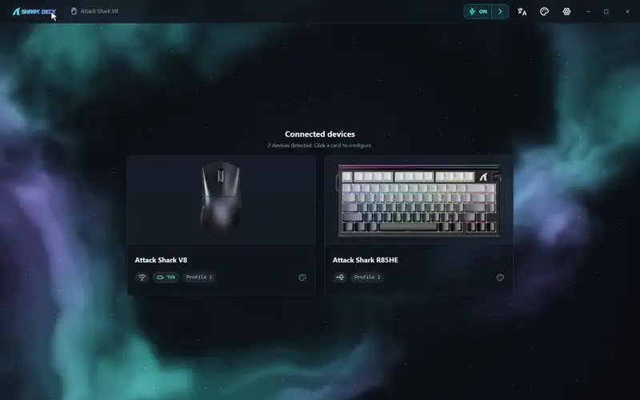</p>

**Per-game auto-switching:** start a game and the mouse and keyboard both move to its profile; close it and they move back.

<p align="center">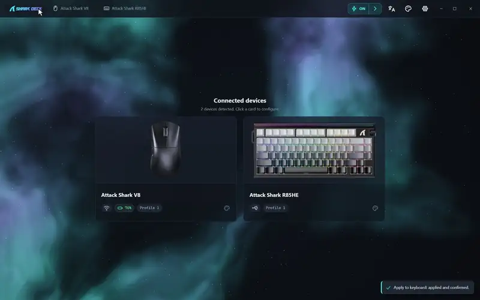</p>

**Themes & languages:** animated backgrounds, colour palettes, eleven languages.

<p align="center">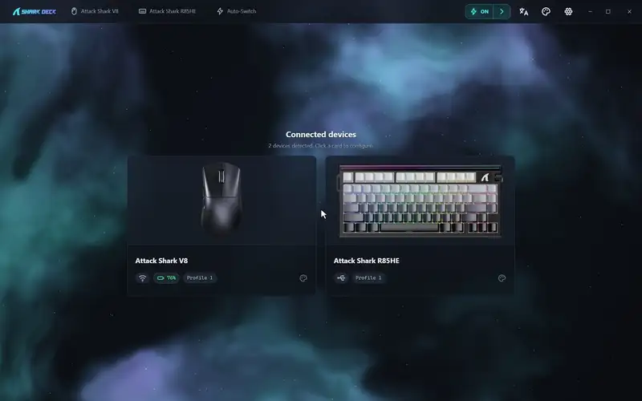</p>

| DPI & polling rate | Sensor & angle mode | Button remapping |
|---|---|---|
| 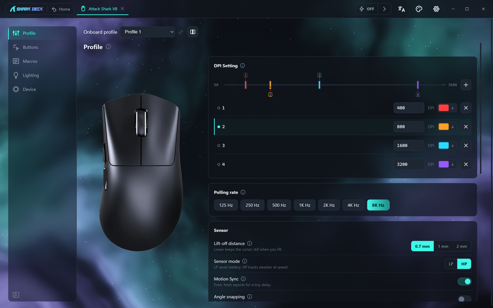 | 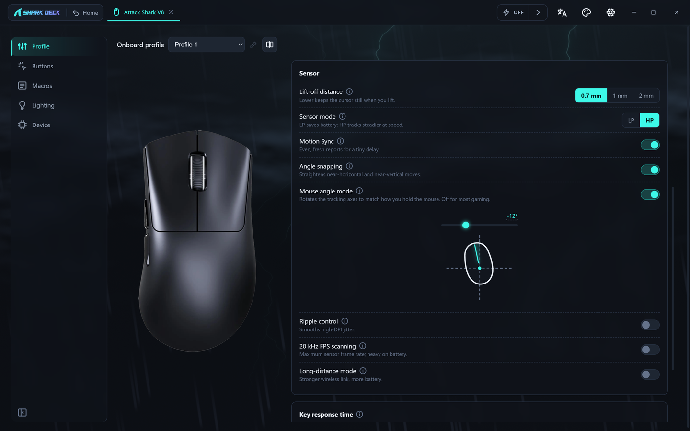 | 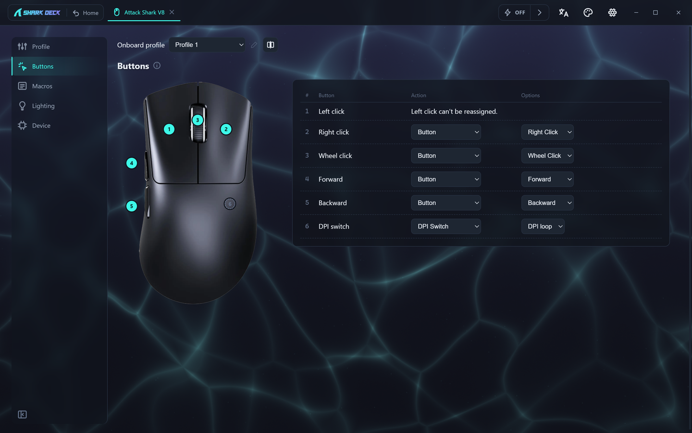 |
| **Live key travel & rapid trigger** | **Lighting effects** | **Per-key RGB** |
| 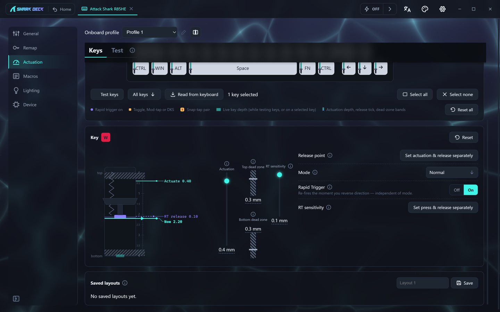 | 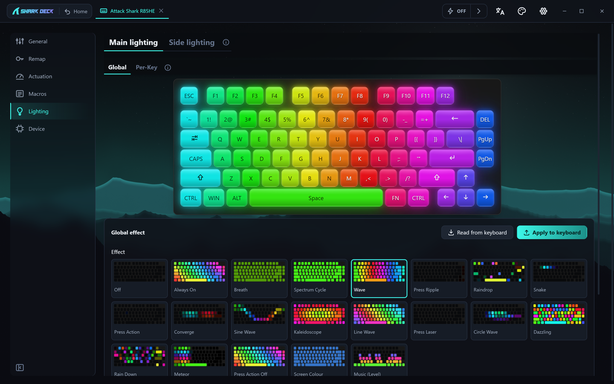 | 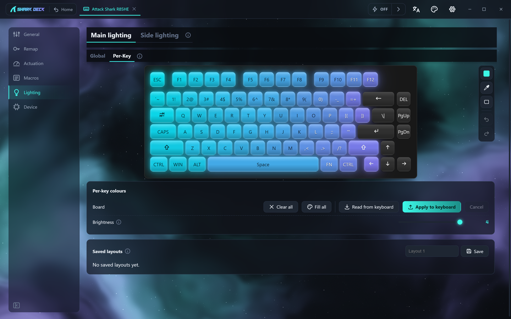 |
| **Macro editor** | **Per-game auto-switching** | **Light theme** |
| 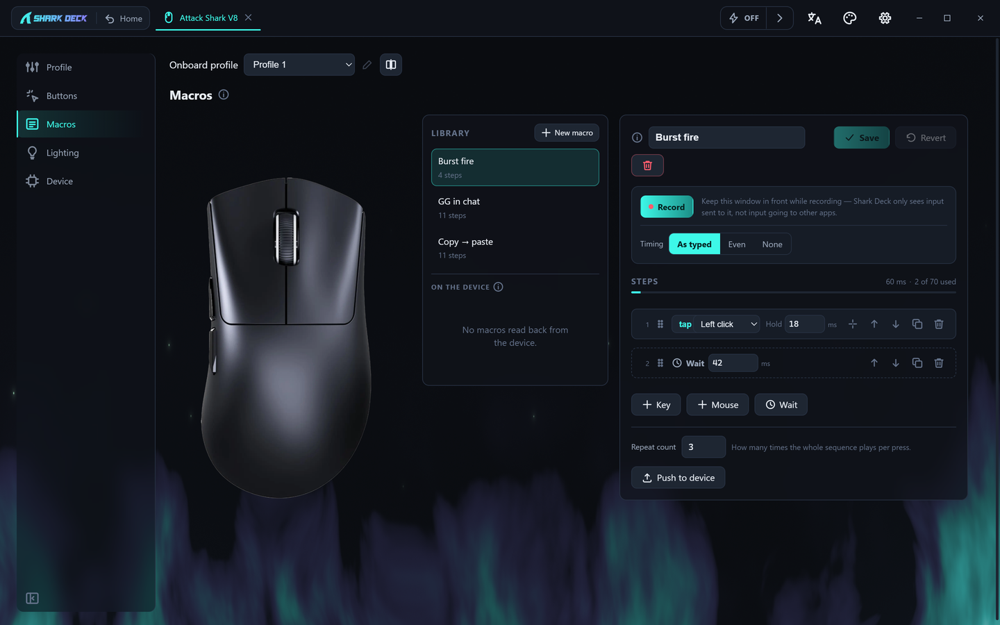 | 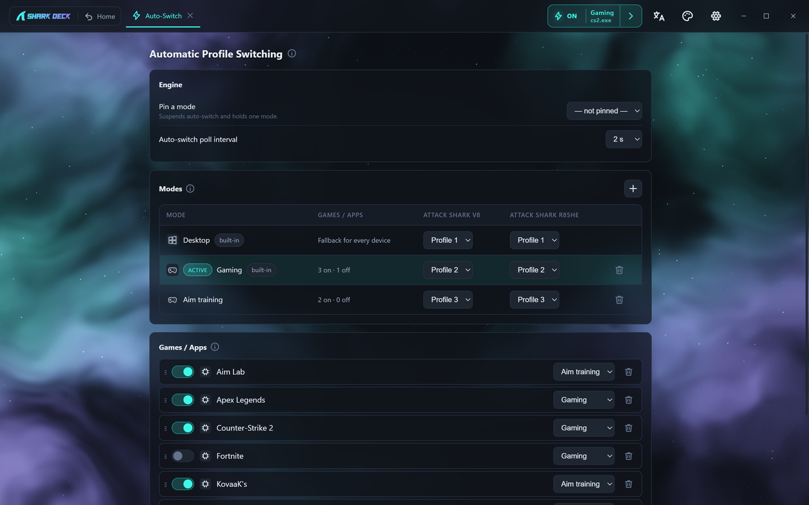 | 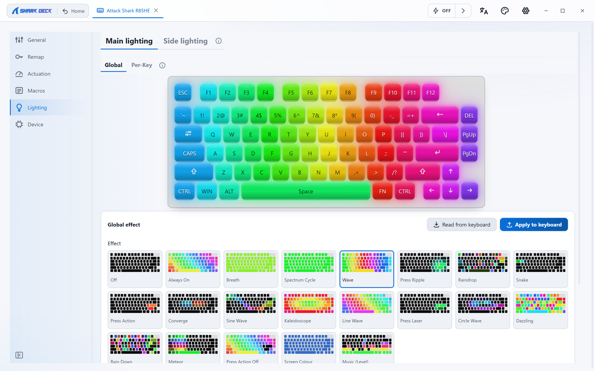 |

### Backgrounds

Nine animated backgrounds, shown here sped up; in the app they drift slowly.

| Aurora | Electricity | Water |
|---|---|---|
| 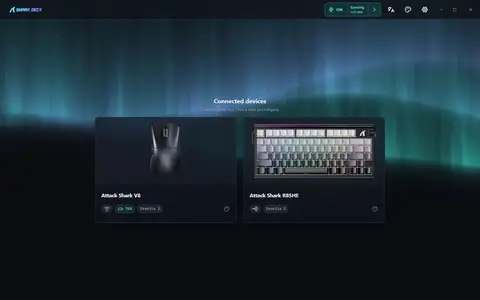 | 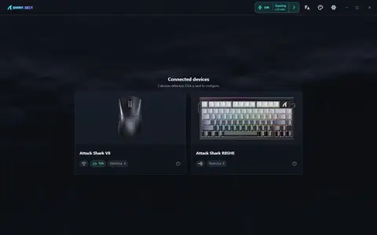 | 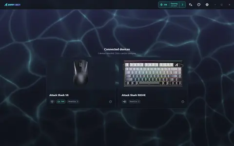 |
| **Rain** | **Fire** | **Nebula** |
| 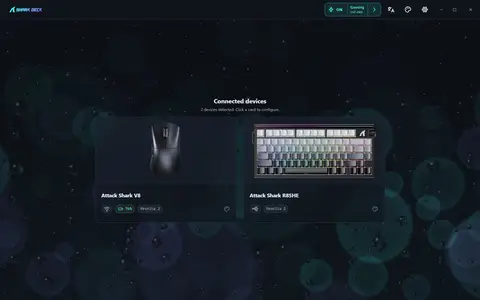 | 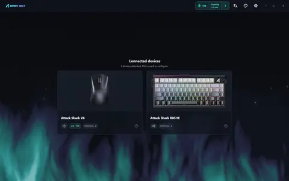 | 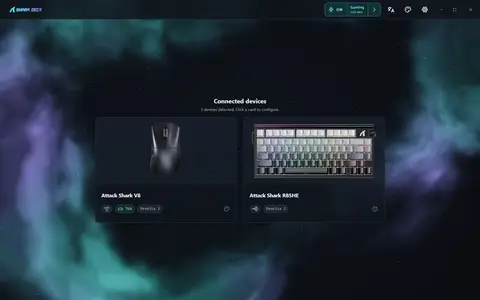 |
| **Lava** | **Smoke** | **Landscape** |
| 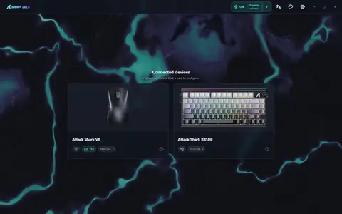 | 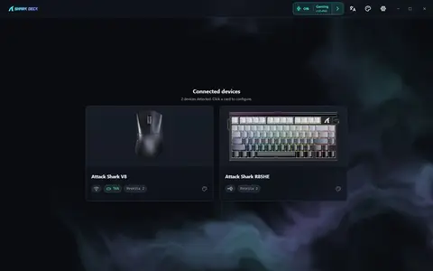 | 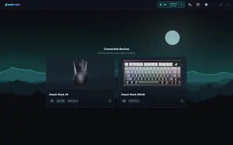 |

## Where things are

| Path | What it is |
|---|---|
| **`app/`** | The application: all source **and** the build environment. You develop and build here. |
| **`dist/`** | Build output only. Produced by `npm run dist`; safe to delete and regenerate. Windows/macOS/Linux each produce their own. |
| `dist/app/` | **Just want to run it? This is the launcher.** Unpacked build, no install — `SharkDeck.exe` (Windows), `SharkDeck.app` (macOS), `sharkdeck` (Linux). |
| `dist/installer/` | `SharkDeck-Setup-*.exe` (Windows NSIS), `SharkDeck-*.dmg` (macOS), `sharkdeck_*.deb` / `sharkdeck-*.rpm` (Linux). |
| `dist/portable/` | `SharkDeck-*-portable.exe` (Windows), `SharkDeck-*.zip` (macOS), `SharkDeck-*.AppImage` (Linux) — one self-contained file, no install. |
| `docs/` | Protocol notes, reverse-engineering captures, the brief & roadmap, the [platform support matrix](docs/platform-support.md). |
| `app/assets/` | App icons (`logo.*`), device art, and `brand/` (wordmark) — all shipped in the asar. |
| `legacy/` | The superseded Python V8 profile switcher, kept for reference. |

## Run the app

Nothing built yet, or you just want to launch it:

```bash
cd app
npm install
npm run dev        # dev build with hot reload
```

Then run the launcher in `dist/app/` after a build (below) — `SharkDeck.exe`
(Windows), `SharkDeck.app` (macOS), `sharkdeck` (Linux).

## Build the distributables

Each OS builds its own installers — there's no cross-compiling a macOS or
Linux build from Windows or vice versa.

```bash
cd app
npm run dist          # this OS's installer + portable -> ../dist/{installer,portable,app}
npm run dist:mac      # macOS only, when not already on macOS's own default target
npm run dist:linux    # Linux only, when not already on Linux's own default target
npm run pack          # unpacked only, fastest -> ../dist/app
```

Requires Node 24 (22.22 or later works). Windows/macOS/Linux — see
[`docs/platform-support.md`](docs/platform-support.md) for the full support
matrix, what's still unverified off Windows, and the per-OS unsigned-build
story (Windows SmartScreen, macOS Gatekeeper, Linux's udev rule for device
access).

On Windows the build needs no admin rights and no Developer Mode:
electron-builder 26 stamps the exe icon with `resedit` (pure JS) rather than
unpacking the `winCodeSign` vendor archive, whose macOS symlinks used to
require the symlink privilege. The old workaround is kept, unwired, as
`npm run prep:wincodesign` — see [`app/README.md`](app/README.md).

### On GitHub

Every push runs the tests on Windows, macOS and Linux
(`.github/workflows/ci.yml`). A push to `main` also builds the installers for
all three, downloadable for two weeks from the run's page under **Actions**
(`.github/workflows/build.yml`).

To release, set the version in `app/package.json`, commit and push, then push
a matching tag:

```bash
git tag v0.1.0
git push origin v0.1.0
```

The tag builds all three platforms again and opens a **draft** release with
every installer attached. Nothing is public until you check the draft on the
repository's **Releases** page and press **Publish**.

## Develop further

- Architecture, conventions and the capability model: [`CLAUDE.md`](CLAUDE.md)
  and [`app/README.md`](app/README.md).
- What's planned and what's unverified: [`docs/roadmap.md`](docs/roadmap.md) —
  note this is a dated, append-only session changelog rather than a reference
  document. For orientation start with [`CLAUDE.md`](CLAUDE.md) and the generated
  file index at [`docs/MAP.md`](docs/MAP.md).
- Wire protocol and its provenance tags: [`docs/protocol/README.md`](docs/protocol/README.md).
- Per-OS support matrix, the udev rule, and unsigned-build workarounds:
  [`docs/platform-support.md`](docs/platform-support.md).

## License

GPL-3.0-or-later.
