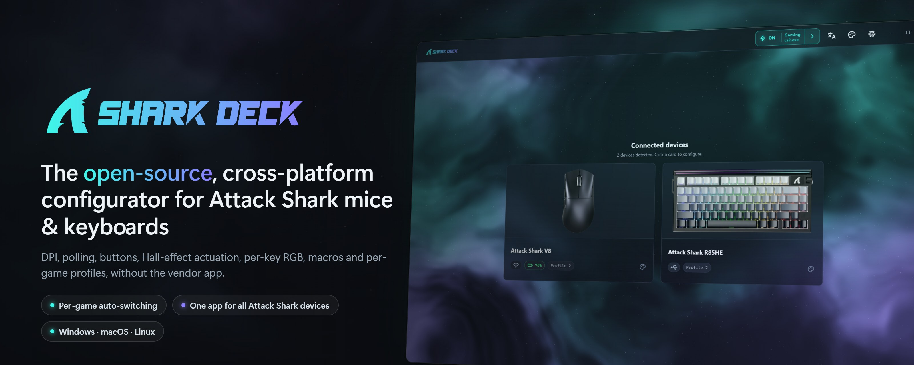
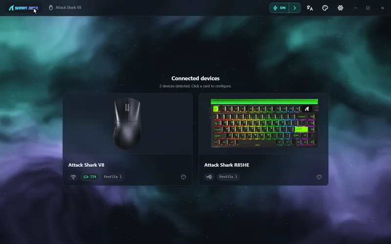
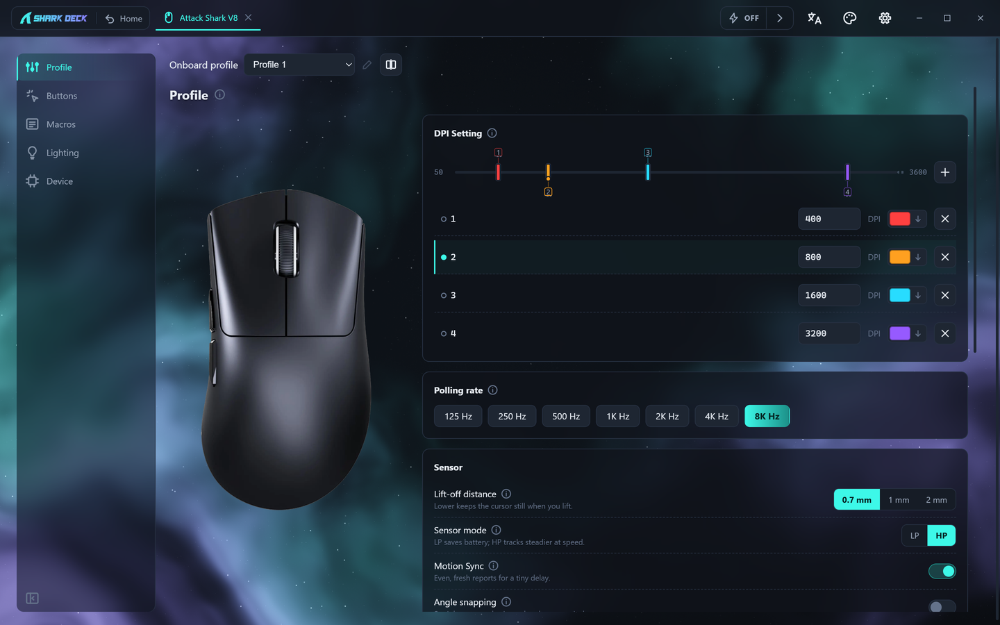
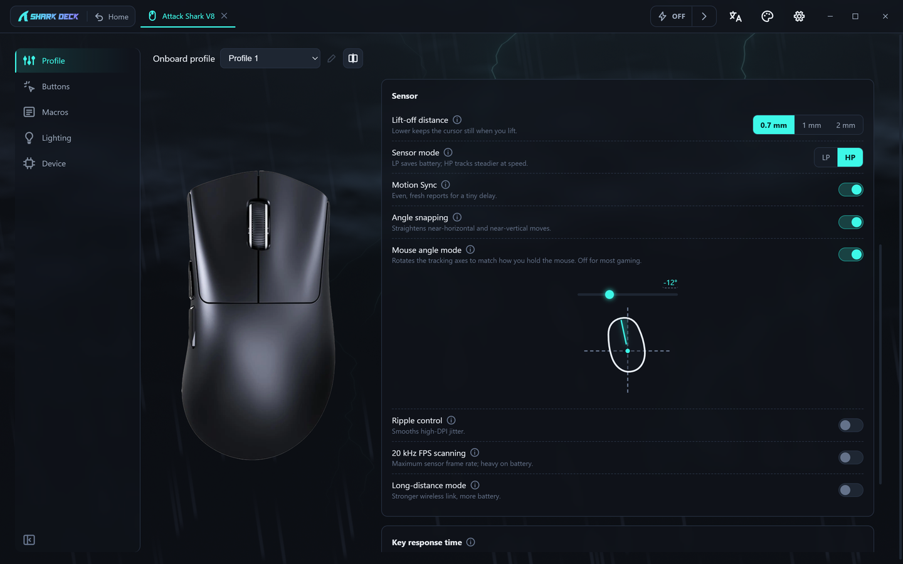
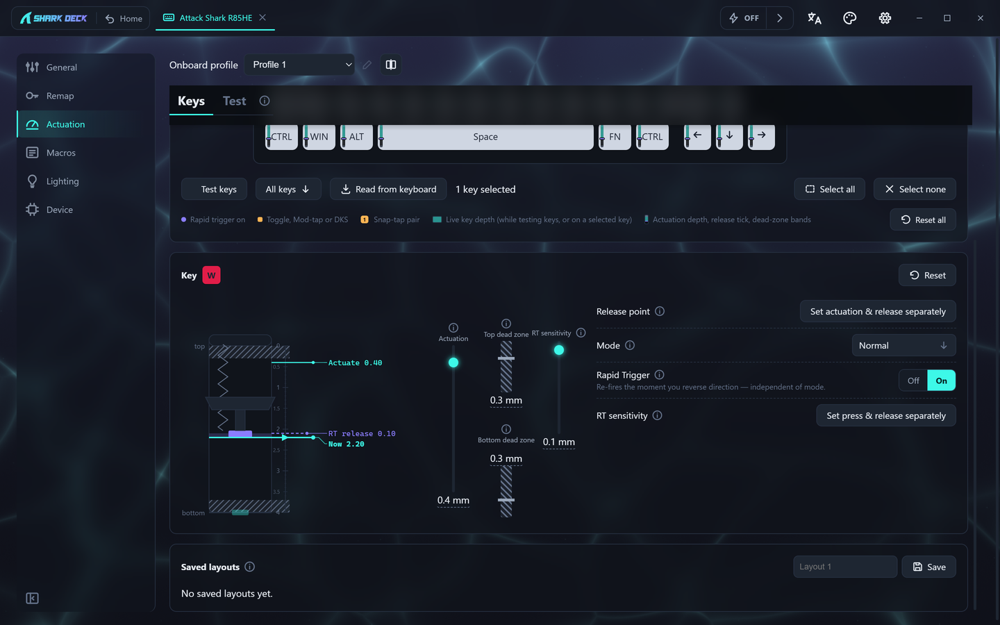
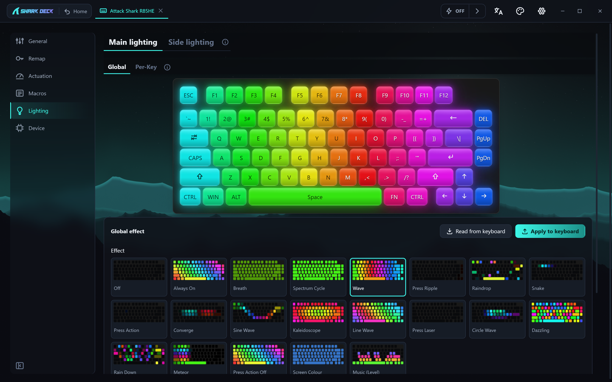
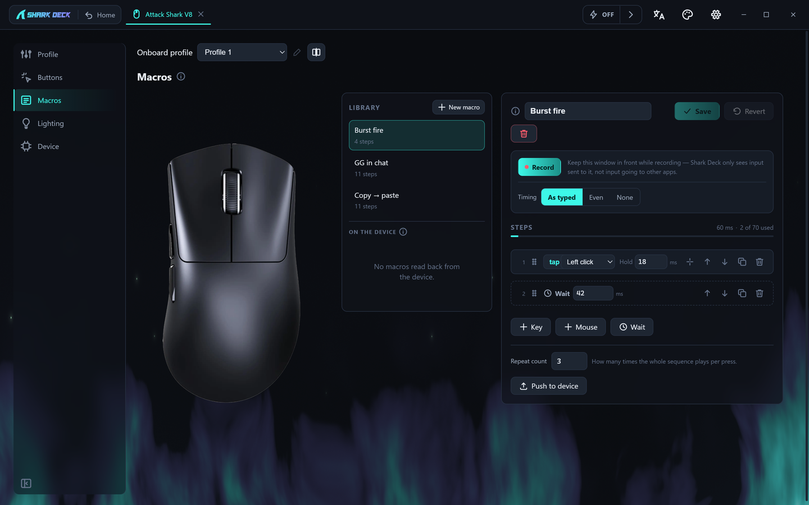
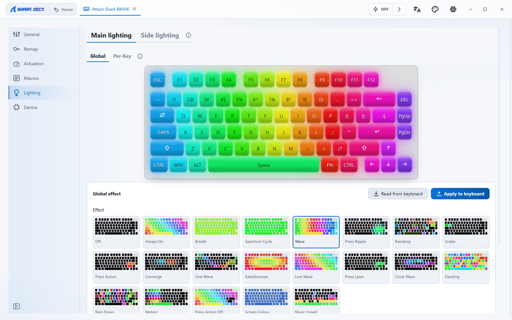

<p align="center"></p>

<p align="center">
  <a href="https://github.com/alexandrewillame/shark-deck/releases/latest"></a>
  <a href="https://github.com/alexandrewillame/shark-deck/actions/workflows/build.yml"></a>
  
  <a href="https://alexandrewillame.github.io/shark-deck/"></a>
  
  <a href="LICENSE"></a>
</p>

# Shark Deck

Open-source configurator for Attack Shark keyboards and mice — an auditable,
offline replacement for the vendor's _Mouse Hub_ and _Driver v4_.

**[Open it in your browser](https://alexandrewillame.github.io/shark-deck/)** ·
[Download for Windows, macOS and Linux](https://github.com/alexandrewillame/shark-deck/releases/latest) ·
[Report a problem](https://github.com/alexandrewillame/shark-deck/issues)

## Supported devices

Shark Deck recognises each device from what its firmware reports, not from its
USB id, and shows only the settings that model has.

- 🟢 **Tested on hardware:** the R85HE keyboard and the V8 mouse.
- 🟡 **Should work, not yet confirmed on a unit:** about 20 more keyboards, and
  the X11 ULTRA, F1 AIR, R2, R3, X3 PRO, R5 ULTRA, R6 and R8 mice.
- 🟠 **Partly supported:** about 60 keyboards (whole-keyboard settings only, until
  their key map is known) and the X8, V5, R11 ULTRA, RS3/RS6 ULTRA, V2 AIR,
  MEGA B2 and R5 TURBO mice (their sensor's common settings), and the X8 PRO
  through its 8K receiver.
- ⚪ **Recognised, not configurable yet:** the other Beken-based mice (the
  original X11, X1, X8 PLUS, R1, X3, X6).

Where a device can report its settings, every change is read back and a backup
is taken first. The full list, model by model:
[docs/devices/attack-shark-lineup.md](docs/devices/attack-shark-lineup.md).
Your device is missing, or only recognised? Run the
[device report tool](docs/devices/attack-shark-lineup.md#missing-a-device) and
send us its report. For a device Shark Deck cannot talk to yet, the tool also
records the official software at work, which is what a new driver is written
from.

Another brand's device on the same chip gets a "Not an Attack Shark device"
card and is never written to.

## Use it in your browser

**[alexandrewillame.github.io/shark-deck](https://alexandrewillame.github.io/shark-deck/)**
is the same configurator with nothing to install. Open it in Chrome, Edge or
Opera on a computer, click **Connect a device** and pick your mouse or keyboard
in the browser's list. It can be installed as an app, and then works offline.

The browser edition configures the device — DPI, buttons, lighting, actuation,
macros, onboard profiles, backups (downloadable as files). What needs software
on the computer stays in the desktop app: per-game auto-switching, the tray
icon, start at login. Firefox and Safari cannot reach USB devices (they have no
WebHID), so there the page points to the desktop app instead; on Linux the
browser needs the udev rule once, and the page shows the commands. Details in
the [platform support matrix](docs/platform-support.md#browser-edition-webhid).

## Walkthrough

**Mouse:** DPI, polling rate, sensor settings, angle mode, buttons, macros, lighting.

<p align="center"></p>

**Keyboard:** Hall-effect actuation with live key travel, rapid trigger, macros, RGB lighting.

<p align="center"></p>

**Per-game auto-switching:** start a game and the mouse and keyboard both move to its profile; close it and they move back.

<p align="center"></p>

| DPI & polling rate | Sensor & angle mode | Button remapping |
|---|---|---|
|  |  |  |
| **Live key travel & rapid trigger** | **Lighting effects** | **Per-key RGB** |
|  |  |  |
| **Macro editor** | **Per-game auto-switching** | **Light theme** |
|  |  |  |

## Where things are

| Path | What it is |
|---|---|
| **`app/`** | The application: all source **and** the build environment. You develop and build here. |
| **`dist/`** | Build output only. Produced by `npm run dist`; safe to delete and regenerate. Windows/macOS/Linux each produce their own. |
| `dist/app/` | **Just want to run it? This is the launcher.** Unpacked build, no install — `SharkDeck.exe` (Windows), `SharkDeck.app` (macOS), `sharkdeck` (Linux). |
| `dist/installer/` | `SharkDeck-Setup-*.exe` (Windows NSIS), `SharkDeck-*.dmg` (macOS), `sharkdeck_*.deb` / `sharkdeck-*.rpm` (Linux). |
| `dist/portable/` | `SharkDeck-*-portable.exe` (Windows), `SharkDeck-*.zip` (macOS), `SharkDeck-*.AppImage` (Linux) — one self-contained file, no install. |
| `docs/` | Protocol notes, reverse-engineering notes, design decisions, the [platform support matrix](docs/platform-support.md). |
| `app/assets/` | App icons (`logo.*`), device art, and `brand/` (wordmark) — all shipped in the asar. |

## Run the app

Nothing built yet, or you just want to launch it:

```bash
cd app
npm install
npm run dev        # dev build with hot reload
npm run dev:web    # or the browser edition, on http://127.0.0.1:5174 (Chrome/Edge)
```

Then run the launcher in `dist/app/` after a build (below) — `SharkDeck.exe`
(Windows), `SharkDeck.app` (macOS), `sharkdeck` (Linux).

## Build the distributables

Each OS builds its own installers — there's no cross-compiling a macOS or
Linux build from Windows or vice versa.

```bash
cd app
npm run dist          # this OS's installer + portable -> ../dist/{installer,portable,app}
npm run dist:mac      # macOS only, when not already on macOS's own default target
npm run dist:linux    # Linux only, when not already on Linux's own default target
npm run pack          # unpacked only, fastest -> ../dist/app
```

Requires Node 24 (22.22 or later works). Windows/macOS/Linux — see
[`docs/platform-support.md`](docs/platform-support.md) for the full support
matrix, what's still unverified off Windows, and the per-OS unsigned-build
story (Windows SmartScreen, macOS Gatekeeper, Linux's udev rule for device
access).

On Windows the build needs no admin rights and no Developer Mode:
electron-builder 26 stamps the exe icon with `resedit` (pure JS) rather than
unpacking the `winCodeSign` vendor archive, whose macOS symlinks used to
require the symlink privilege. The old workaround is kept, unwired, as
`npm run prep:wincodesign` — see [`app/README.md`](app/README.md).

## Develop further

- Architecture, conventions and the capability model: [`app/README.md`](app/README.md).
- Wire protocol and its provenance tags: [`docs/protocol/README.md`](docs/protocol/README.md).
- Per-OS support matrix, the udev rule, and unsigned-build workarounds:
  [`docs/platform-support.md`](docs/platform-support.md).

## License

Copyright © 2026 Alexandre Willame. Shark Deck is free software under the
[GNU General Public License, version 3 or later](LICENSE): you may use, study,
share and change it; versions you distribute must stay under the same license,
with their source, and keep this copyright notice. It comes with no warranty.
